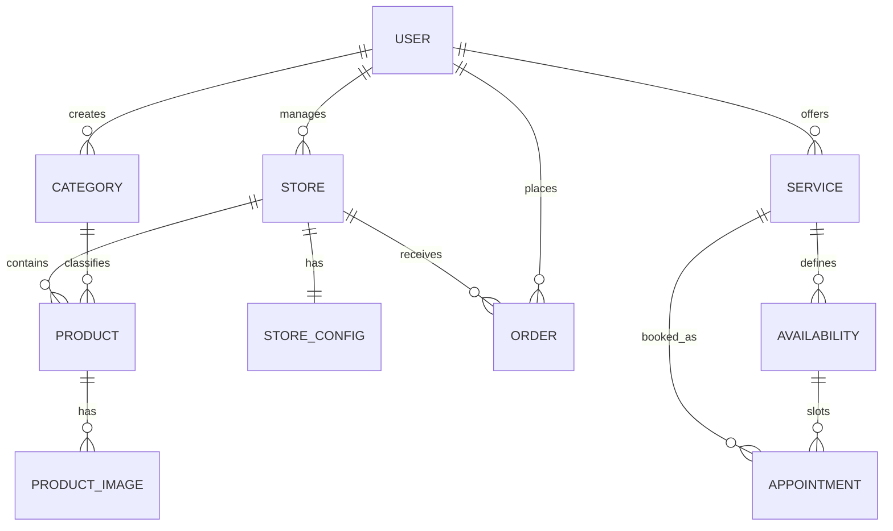
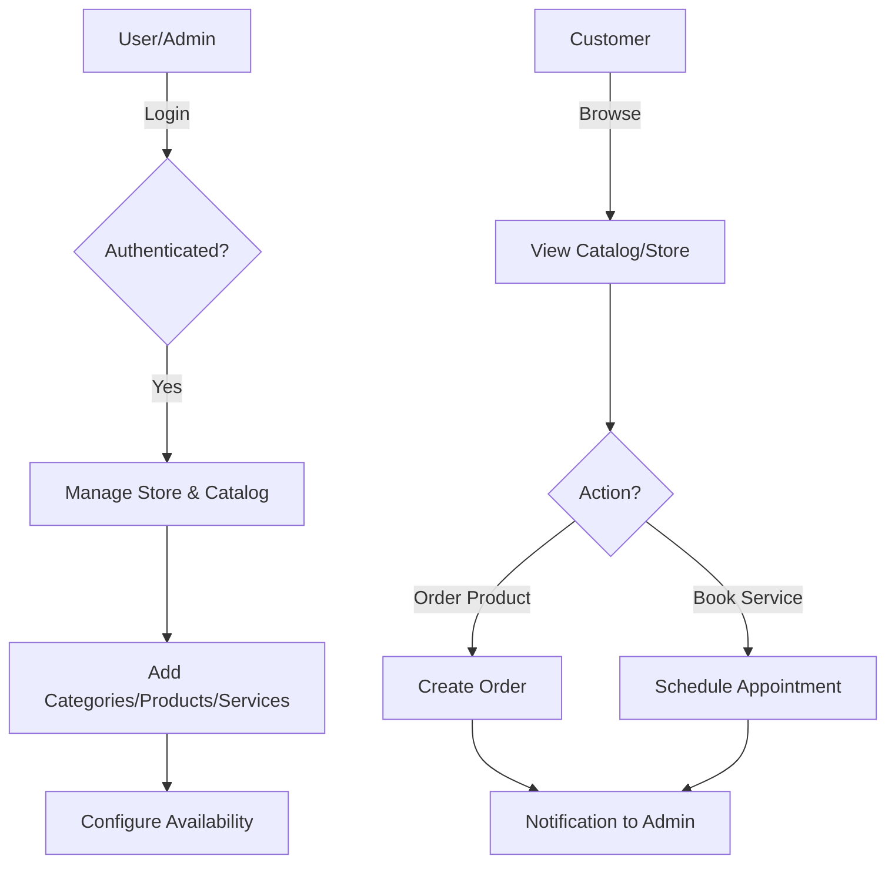

# IntelliCatalog Backend

IntelliCatalog is a robust and flexible digital catalog management system designed for businesses to showcase products and services. This backend provides a comprehensive API to manage stores, product catalogs, service bookings, and customer orders.

## 🚀 Features

- **Store Management:** Custom branding (colors, logos), contact info (WhatsApp, Instagram), and delivery settings.
- **Catalog Management:** Organize products and services into custom categories with support for images.
- **Service Booking:** Integrated availability system for scheduling and managing appointments.
- **Order System:** Streamlined order processing for products and services.
- **Secure Authentication:** JWT-based user authentication and password encryption.
- **Automated Communication:** Email notifications via Nodemailer.
- **Image Processing:** Optimized image uploads and processing.

## 🛠️ Tech Stack

- **Runtime:** Node.js
- **Framework:** Express.js
- **Database:** MySQL with Sequelize ORM
- **Authentication:** JWT (JSON Web Tokens) & Bcrypt
- **File Handling:** Multer & Sharp
- **Email:** Nodemailer
- **Integrations:** Google APIs

## 📊 System Architecture

### Entity-Relationship Diagram



### Core Workflow



## ⚙️ Getting Started

### Prerequisites
- Node.js (v14+)
- MySQL Database

### Installation

1. Clone the repository:
   ```bash
   git clone <repository-url>
   ```
2. Install dependencies:
   ```bash
   npm install
   ```
3. Configure environment variables:
   Create a `.env` file based on the project requirements (DB credentials, JWT secret, etc.).
4. Initialize the database:
   Use the provided `bd.sql` script to set up the schema.
5. Start the server:
   ```bash
   npm start
   ```

## 🛣️ API Endpoints

- `/intellicatalog/v1/users` - User Auth & Profile
- `/intellicatalog/v1/category` - Category Management
- `/intellicatalog/v1/product` - Product Operations
- `/intellicatalog/v1/store` - Store Configuration
- `/intellicatalog/v1/services` - Service Management
- `/intellicatalog/v1/availability` - Booking Slots
- `/intellicatalog/v1/orders` - Order Processing

---

### Repository Description (GitHub)
Robust Node.js backend for IntelliCatalog, a comprehensive digital catalog and appointment management system. Features include store customization, product/service management, real-time availability scheduling, and order processing.
